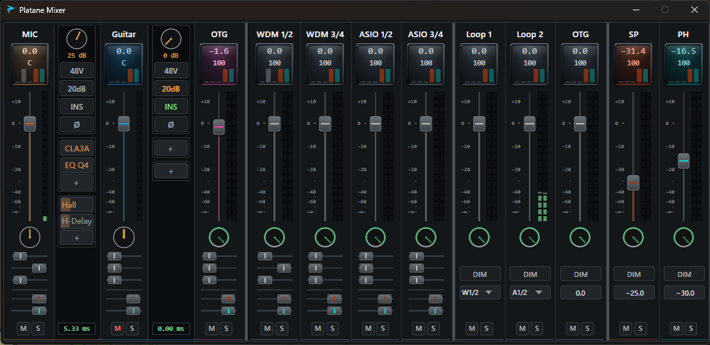

# Platane Mixer

[中文](README.md)

> **Personal project, non-commercial use only. Platane UP2 SE only.**
>
> This project is not affiliated with or endorsed by Platane, Native Instruments, Steinberg,
> or any other vendor.

Platane Mixer is a replacement control surface for the Platane UP2 SE. The installer deploys
the official driver together with the new console. Source code is private. This repository
publishes binary installers, release notes, and changelogs only.

<p align="center">
  
</p>

## Download

Download the latest `PlataneMixer-Setup-<version>.exe` from [Releases](../../releases).

Current version: `0.3.1`

SHA-256:

```text
4D41756A032A4DAD6E0B3B938AFB512BE040E9F911E2E15F1B32E490748165E2
```

## Features

### Device and console

- Automatic UP2 SE detection with device, firmware, and driver versions.
- Device reset from the connected state.
- Resident audio service separated from the UI; closing the console or tray does not stop ASIO audio.
- Tray controls, single/double-click activation, always-on-top, zoom, startup launch, and global show hotkey.
- Global volume/mute hotkeys and tray-wheel volume control.
- Dark, light, and system themes.
- Chinese, English, and system-following UI languages.
- Window-position persistence and screen-edge snapping.

### Channels and mixing

- IN1, IN2, OTG input, WDM 1/2–9/10, and ASIO 1/2–9/10.
- Loop 1 (WDM loopback), Loop 2 (ASIO loopback), OTG output, SP, and PH.
- Channel visibility and saved layouts.
- Main faders, send faders, mute, solo, pan, and stereo-width knobs.
- Stereo width: `100` normal stereo, `0` mono, `-100` reversed stereo.
- Fader and parameter groups with relative linking.
- Smooth fader/knob animation, double-click reset, scale jumps, and wheel adjustment.
- Calibrated record/playback level for a centered mono IN through an unprocessed ASIO Loop.

### IN inputs

- Gain, 48V, 20 dB pad, Hi-Z/INS, and phase invert.
- A 2-second forced mute on the affected MIC channel when toggling 48V.
- Built-in insert processing plus third-party Insert and Send slots.
- Private ASIO return preserves fader, pan, width, mute/solo, and sends after processing.
- A valid IN-to-ASIO Loop record path remains available when no plugin is loaded.

### Sends and loopback

- Five sends: SP, OTG, PH, WDM Loop, and ASIO Loop.
- Send range `0–100`, with `0 dB` as maximum.
- Selectable WDM and ASIO loopback destinations.
- Loop fader, mute, solo, DIM, and stereo width process the final post-send signal.
- Loop meters and route recovery after restart or USB reconnect.
- Independent WDM and ASIO loopback channel selection.

### Plugins

- VST2, VST3, and CLAP effect scanning and loading.
- Standards-based filtering of instruments, ARA/ARA2, and non-2.0 layouts; plugin names are not used as type guesses.
- Native plugin windows sized according to the plugin’s supported size.
- Click to enable/disable, double-click or right-click for the editor, drag reorder, rename, replace, and delete.
- Send plugins support drag and wheel level adjustment.
- Plugin state, parameters, aliases, and topology are saved with user data and presets.
- Background plugin preloading after the audio engine starts.

### Presets and settings

- Preset create/save-as/rename/delete/load and restore-default operations.
- Mixer parameters, visibility layouts, plugin state, and console settings are saved.
- 48V, global output calibration, and shortcuts use independent durable storage.
- Sample-rate, buffer-size, and standalone ASIO panel controls.
- Plugin directories, scanning, failed-only rescan, and search.
- Speaker/headphone calibration: `+15 dB`, `0 dB`, and `-15 dB`; default is 15 dB below the official output.
- Speaker, headphone, OTG, and Loop levels, mute, DIM, and defaults.

### Volume OSD

- Windows 11-style translucent OSD.
- Speaker, headphone, or both controlled independently according to the active control target.
- Volume bar follows the channel color; mute is shown with a slash icon.
- Fade/slide animation with automatic hide after two seconds.

## Installation

1. Close DAWs, players, and any application using Platane ASIO.
2. Run `PlataneMixer-Setup-<version>.exe` as administrator.
3. The installer reuses the unmodified official driver and registers the resident audio service.
4. If Windows does not detect the interface after the first install or USB re-enumeration, unplug/replug it once or restart Windows.
5. Re-select Platane ASIO in the DAW, or reopen the DAW audio settings if necessary.

## Important notes

- **Platane UP2 SE only.** UP1, UP2, and other devices are not adapted or supported.
- This is a personal tool with no commercial support or availability guarantee.
- The installer is not commercially code-signed; Windows SmartScreen may show an unknown-publisher warning.
- Official `.sys`, `.inf`, and `.cat` driver files are shipped unchanged to preserve vendor signatures.
- Updating restarts the audio stack. Active WDM/ASIO playback may briefly stop, and some systems may show a momentary volume change.
- Some older DAWs, VSTis, or closed ASIO applications cannot change sample rate or buffer size while running; reopen the application or reset its audio engine.
- USB suspend, docks, GPU audio, and power-management behavior belong to the system/hardware stack and cannot be fully fixed by this application.
- Save projects and back up `%LOCALAPPDATA%\PlataneMixer2` before install, update, or uninstall.
- Uninstall can optionally remove user data. By default, shortcuts, output calibration, presets, plugin state, and window layout are preserved.

## Privacy

The installer contains no telemetry, account system, or online analytics. Plugin scanning and
configuration remain local.

## Disclaimer

This is a personal, non-commercial project and is not authorized or endorsed by any hardware or
software vendor. Use at your own risk.

