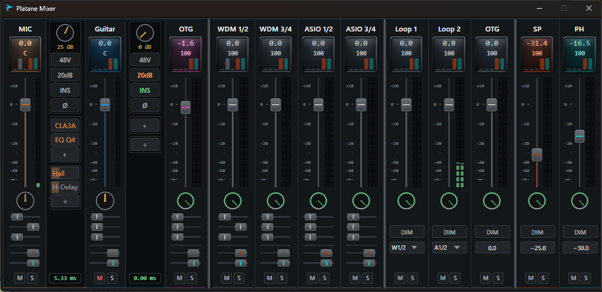

# Platane Mixer

[English](README.en.md)

> **个人项目，无任何商业用途。仅适用于 Platane UP2 SE。**
>
> 本项目与 Platane、Native Instruments、Steinberg 及其他厂商无隶属或授权关系。

Platane Mixer 是 Platane UP2 SE 官方控制台的替代方案，安装包同时包含驱动部署和新控制台。源代码不公开；本仓库只发布可供下载的安装包、发行说明和更新日志。

<p align="center">
  
</p>

## 下载

请从 [Releases](../../releases) 下载最新的 `PlataneMixer-Setup-<版本>.exe`。

当前版本：`0.3.1`

SHA-256：

```text
4783F4B61496CE33307D0E078E25583F4041C9EE45BCE6645423AA91DC72155C
```

## 功能

### 设备与控制台

- 自动识别 UP2 SE，并显示设备、固件和驱动版本。
- 设备连接状态下可直接重置设备状态。
- 常驻音频服务与 UI 分离；关闭控台或托盘不会主动中断 ASIO 音频。
- 托盘菜单、单击/双击呼出、置顶、缩放、开机启动、全局呼出快捷键。
- 全局音量、静音快捷键和托盘滚轮控制。
- 深色、浅色、跟随系统三种主题。
- 中文、英文、跟随系统三种界面语言。
- 窗口位置记忆、屏幕边缘吸附、托盘菜单跟随主题。

### 通道与调音

- IN1、IN2、OTG 输入、WDM 1/2 至 9/10、ASIO 1/2 至 9/10。
- Loop 1（WDM Loopback）、Loop 2（ASIO Loopback）、OTG 输出、SP、PH。
- 通道显示/隐藏与布局保存。
- 主推子、发送推子、静音、独奏、声相、立体声宽度旋钮。
- 立体声宽度：`100` 为正常立体声，`0` 为单声道，`-100` 为左右反向。
- 推子编组和参数编组，支持相对联动。
- 平滑推子和旋钮动画；双击复位、点击刻度跳转、滚轮细调。
- 单声道 IN 的居中声像、无插件 ASIO Loop 录放电平校准。

### IN 输入

- 增益、48V、20dB、Hi-Z/INS、反相控制。
- 48V 切换时对当前 MIC 通道强制静音 2 秒。
- 内置 Insert 处理和第三方 Insert/Send 插件槽。
- IN 处理后通过私有 ASIO 回传，保留推子、声相、宽度、静音/独奏和发送。
- 无插件时仍保留 IN 到 ASIO Loop 的有效录音路径。

### 发送与 Loopback

- SP、OTG、PH、WDM Loop、ASIO Loop 五路发送。
- 发送范围 `0–100`，最高为 `0 dB`。
- 可选择的 WDM 与 ASIO Loopback 目标通道。
- Loop 推子、Mute、Solo、DIM、立体声宽度作用于发送后的最终信号。
- Loop 电平表、目标切换、重启和 USB 重连后的路由恢复。
- WDM 与 ASIO Loopback 相互独立，可选择不同通道。

### 插件

- 支持 VST2、VST3、CLAP 效果器扫描和加载。
- 按插件规范过滤乐器、ARA/ARA2 和非 2.0 通道布局；不按插件名称猜类型。
- 原生插件窗口，窗口尺寸以插件实际支持范围为准。
- 单击启用/禁用，双击或右键打开插件界面，拖动排序，重命名、更换、删除。
- Send 插件支持拖动和滚轮调整发送量。
- 插件状态、参数、名称和拓扑保存到用户配置与预置。
- 音频引擎启动后在后台预加载插件。

### 预置与设置

- 增删改预置、恢复默认、异步加载。
- 保存通道参数、显示布局、插件状态和控台设置。
- 48V、全局音量校正和快捷键使用独立持久配置。
- 采样率、缓冲、ASIO 独立小面板。
- 插件目录、扫描、失败重扫和插件搜索。
- 音箱/耳机输出校正：`+15 dB`、`0 dB`、`-15 dB`，相对官方输出默认小 15 dB。
- 音箱、耳机、OTG 和 Loop 输出音量、静音、DIM、默认值。

### 音量 OSD

- Windows 11 风格半透明 OSD。
- 音箱、耳机或两者同时调整时按控制目标独立显示。
- 音量条跟随通道颜色，静音使用图标斜线提示。
- 自动上浮淡入、下沉淡出，并在 2 秒后隐藏。

## 安装

1. 完全退出 DAW、播放器和其他正在使用 Platane ASIO 的程序。
2. 运行 `PlataneMixer-Setup-<版本>.exe`，需要管理员权限。
3. 安装器会复用包内未修改的官方驱动，并注册常驻音频服务。
4. 首次安装或 USB 设备重新枚举后，如果系统暂时未识别声卡，请拔插声卡或重启一次。
5. 回到 DAW 后重新选择 Platane ASIO，或重开 DAW 的音频设置。

## 注意事项

- **仅支持 Platane UP2 SE**。UP1、UP2 或其他型号没有完成界面、通道和硬件协议适配。
- 本项目是个人开发、自用工具，不提供商业支持或可用性保证。
- 安装包没有商业代码签名，Windows SmartScreen 可能显示未知发布者提示。
- 驱动 `.sys`、`.inf`、`.cat` 保持官方原样，不修改官方签名文件。
- 升级会重启音频栈；正在播放的 WDM/ASIO 音频可能短暂中断，部分系统上可能出现一次瞬时音量变化。
- 个别老 DAW、VSTi 或封闭式 ASIO 应用不支持运行中切换采样率/缓冲，可能需要重开应用或重新初始化音频设置。
- USB 待机、扩展坞、显卡音频和省电策略属于系统/硬件链路；软件不能替代主板、EC 和 USB 驱动修复。
- 安装、升级或卸载前建议保存工程并备份 `%LOCALAPPDATA%\PlataneMixer2`。
- 卸载时可选择是否同时删除用户配置。默认保留快捷键、音量校正、预置、插件参数和窗口布局。

## 隐私

安装包不包含遥测、账号系统或在线分析。插件扫描和配置只在本机完成。

## 声明

本项目为个人行为，无任何商业用途，也不代表任何硬件或软件厂商。使用本软件造成的设备设置变化、工程异常或数据损失由使用者自行承担风险。

